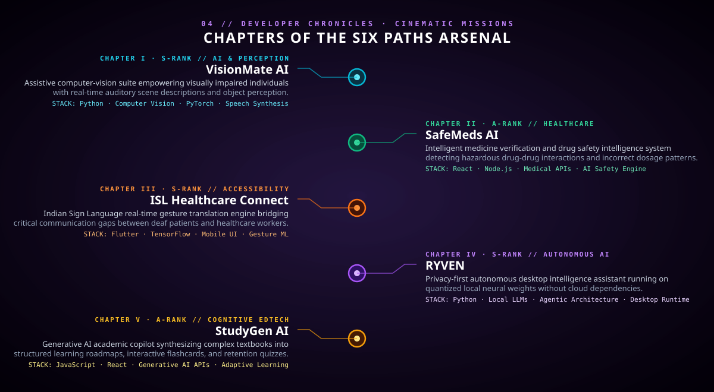

<!-- ==================== SCENE 1: UNIFIED CINEMATIC OPENING (AVATAR + RINNEGAN + HUD) ==================== -->

  

  

> ### 🌀 **[ENTER THE LIVING 3D SHINOBI INTERACTIVE UNIVERSE ↗](https://sakthirenganathan.vercel.app)**
> *Experience full-screen Three.js chakra particle cosmos, live GitHub telemetry, interactive orbital jutsu, and GSAP motion storytelling.*

  

<!-- ==================== SCENE 2: LIVE HOLOGRAPHIC TELEMETRY ==================== -->

  

<!-- DYNAMIC REAL-TIME COMMIT STREAK STATS (RINNEGAN DARK PURPLE THEME) -->

  

<!-- ==================== SCENE 3: LIVING CHAKRA TECH ORBIT ==================== -->

  

<!-- ==================== SCENE 4: CONTINUOUS CHARACTER CONTINUUM ==================== -->

  

<!-- ==================== SCENE 5: CINEMATIC PROJECT CHRONICLES ==================== -->

 

[**VisionMate AI ↗**](https://github.com/sakthirenganathan-dev/VisionMate-AI) &nbsp;·&nbsp; [**SafeMeds AI ↗**](https://github.com/sakthirenganathan-dev/safeMedesAi) &nbsp;·&nbsp; [**ISL Healthcare Connect ↗**](https://github.com/sakthirenganathan-dev/isl-healthcare) &nbsp;·&nbsp; [**RYVEN ↗**](https://github.com/sakthirenganathan-dev/RYVEN) &nbsp;·&nbsp; [**StudyGen AI ↗**](https://github.com/sakthirenganathan-dev/StudyGenAi)

  

<!-- ==================== SCENE 6: HIDDEN LEAF 3D CONTRIBUTION SKYLINE ==================== -->

  

<!-- ==================== SCENE 7: SUMMONING PORTAL (ALLIANCE) ==================== -->

  

### **“A shinobi never gives up on the code they believe in.”**

 

SHINOBI: THE SIX PATHS · Designed with unified cinematic SVG compositions, live GitHub Action telemetry synchronization, dynamic commit streaks, and Three.js interactive web universe. Unofficial non-commercial anime fan presentation.

