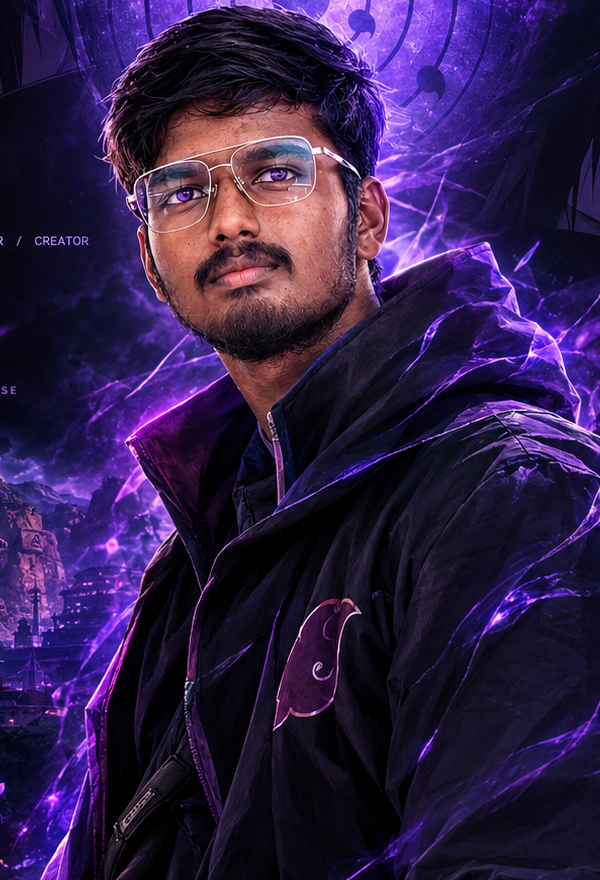
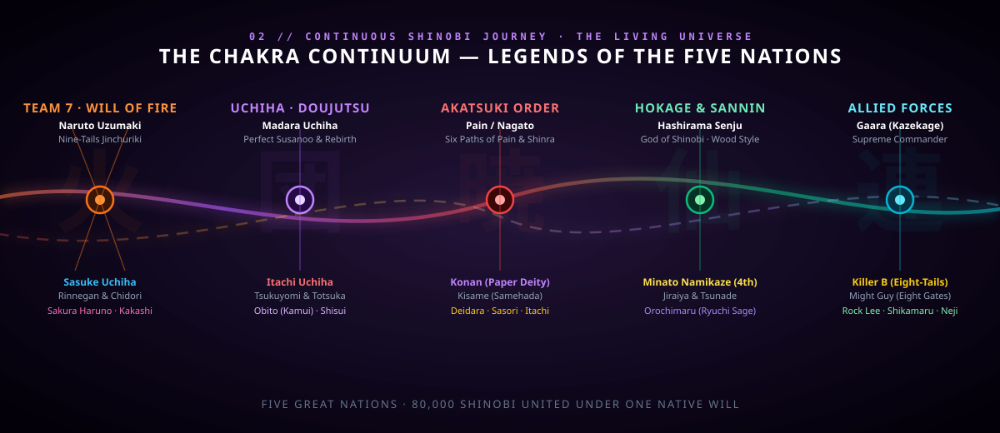
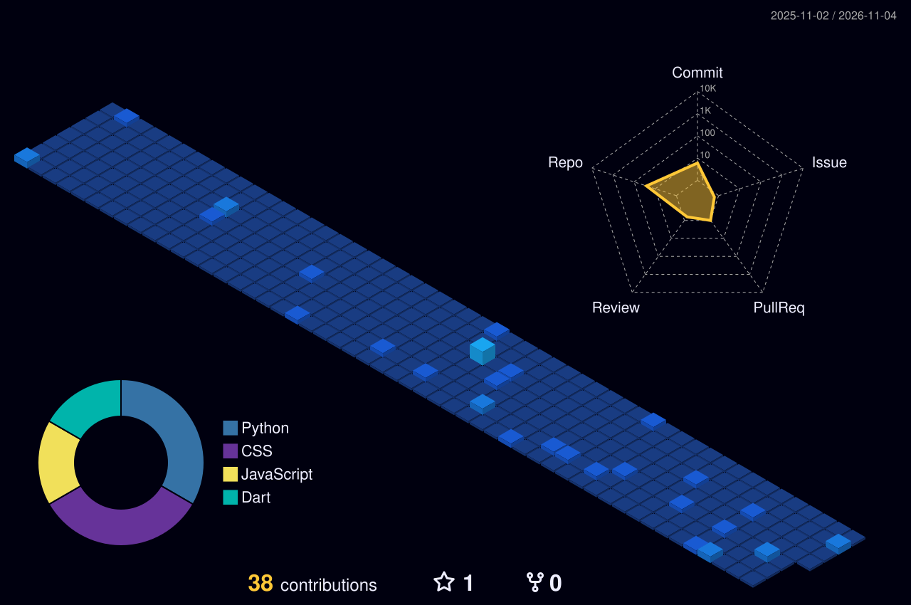

### 影 · SAKTHI RENGANATHAN · SHINOBI DEVELOPER

**Full-Stack Developer · AI Builder · Anime World Explorer**

  
   
  SAKTHI · SIX PATHS SHINOBI · ORIGINAL FAN-STYLE CHARACTER ART

---

## 🍥 SHINOBI ARCHIVE — THE NARUTO UNIVERSE

A fan-themed character directory, grouped by their story factions. This is a curated major-character roster, not a claim to include every background character in the franchise.

| Faction | Characters |
|---|---|
| Team 7 & mentors | Naruto Uzumaki, Sasuke Uchiha, Sakura Haruno, Kakashi Hatake, Sai, Yamato |
| Konoha legends | Hashirama Senju, Tobirama Senju, Hiruzen Sarutobi, Minato Namikaze, Tsunade, Jiraiya, Orochimaru |
| Uchiha clan | Madara Uchiha, Obito Uchiha, Itachi Uchiha, Shisui Uchiha, Fugaku Uchiha, Izuna Uchiha, Sarada Uchiha |
| Akatsuki | Pain / Nagato, Konan, Kisame Hoshigaki, Deidara, Sasori, Hidan, Kakuzu, Zetsu |
| Konoha shinobi | Might Guy, Rock Lee, Neji Hyuga, Tenten, Shikamaru Nara, Ino Yamanaka, Choji Akimichi, Hinata Hyuga, Kiba Inuzuka, Shino Aburame, Asuma Sarutobi, Kurenai Yuhi |
| Sand & allied villages | Gaara, Temari, Kankuro, Chiyo, Killer B, A, Mei Terumi, Onoki, Mu, Gengetsu Hozuki |
| Other major figures | Kurama, Killer B, Hashirama's tailed-beast era rivals, Kaguya Otsutsuki, Hagoromo Otsutsuki, Hamura Otsutsuki |

## ⚡ CHAKRA TECH ORBIT

**Core toolkit:** HTML · CSS · JavaScript · Java · React · Flutter · Git · GitHub  
**Exploring:** AI engineering · Three.js · GSAP · backend integrations

## 🪪 SHINOBI ID / LIVE DASHBOARD

## 🏯 PROJECT SCROLLS

| Project | Mission |
|---|---|
| [VisionMate AI](https://github.com/sakthirenganathan-dev/VisionMate-AI) | Assistive AI experience |
| [SafeMeds AI](https://github.com/sakthirenganathan-dev/safeMedesAi) | Medicine information and safety |
| [ISL Healthcare](https://github.com/sakthirenganathan-dev/isl-healthcare) | Sign-language healthcare access |
| [RYVEN](https://github.com/sakthirenganathan-dev/RYVEN) | Local AI assistant project |
| [StudyGen AI](https://github.com/sakthirenganathan-dev/StudyGenAi) | AI-powered study workflow |

> Project descriptions are concise labels; open each repository for its current implementation and status.

## 🌃 HIDDEN LEAF — CONTRIBUTION CITY

The contribution skyline is generated by the workflow in `.github/workflows/profile-city.yml`. It updates the contribution visualization daily.

  

## 🌀 CONNECT / FORM A TEAM

**“A shinobi never gives up on the code they believe in.”**

[GitHub](https://github.com/sakthirenganathan-dev) · [LinkedIn](https://linkedin.com/in/sakthi-renganathan-k) · [Portfolio](https://sakthirenganathan.vercel.app)

---

SHINOBI · THE DEVELOPER CHRONICLES — custom-built animated SVG profile. Naruto character names and universe references are fan-themed; this is an unofficial, non-commercial fan presentation.
